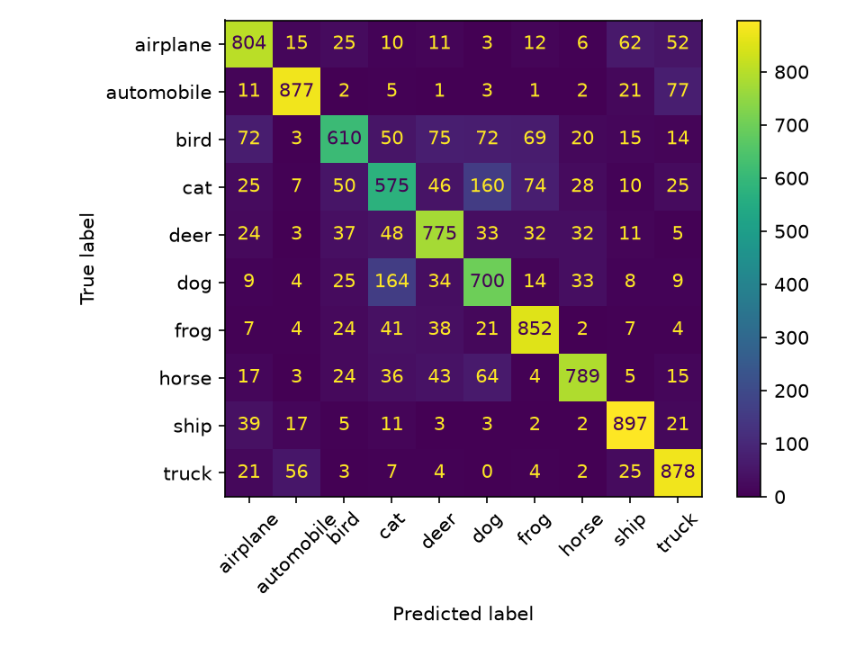
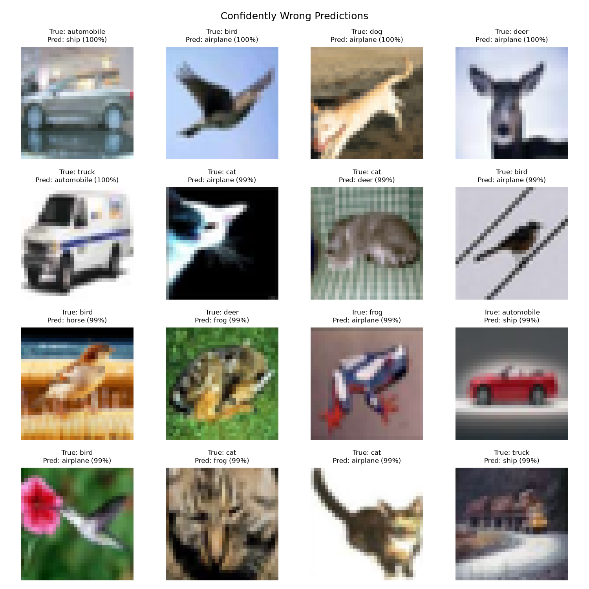
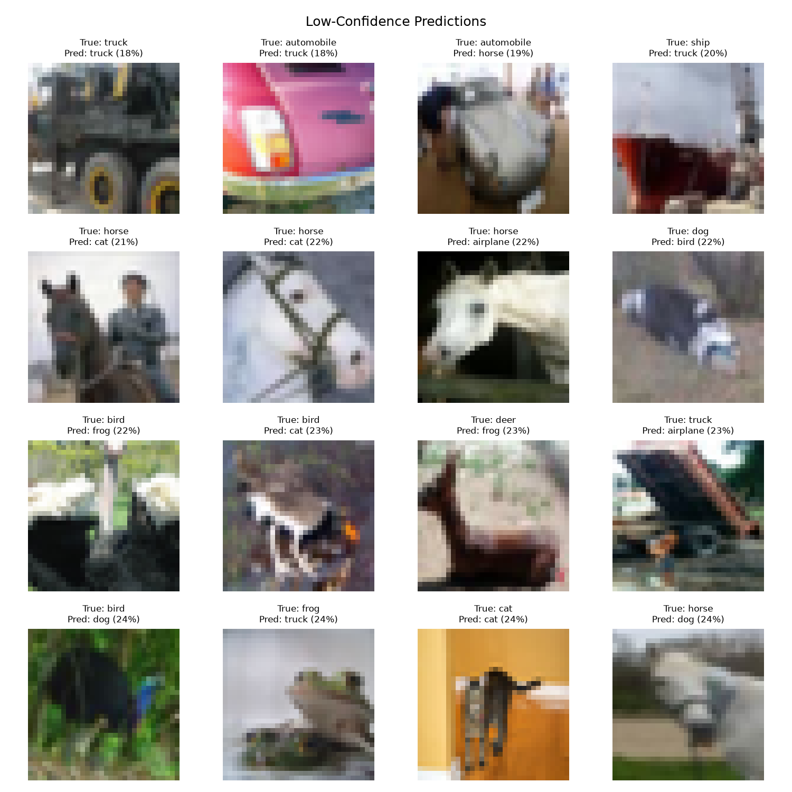

# CIFAR-10 CNN Project Report

## Result At A Glance

This project trains a small convolutional neural network (CNN) to classify
CIFAR-10 images into 10 classes. The final selected model achieved:

```text
Final test accuracy: 77.57%
Final test loss:     0.6541
Selected checkpoint: Epoch 17
```

The final test set contains 10,000 images that were not used to choose the
model settings.

## Problem

CIFAR-10 contains 60,000 color images with a size of `32 x 32` pixels. Each
image belongs to one class:

```text
airplane, automobile, bird, cat, deer,
dog, frog, horse, ship, truck
```

The data was split into:

| Split | Images | Purpose |
| --- | ---: | --- |
| Training | 45,000 | Learn model weights and biases |
| Validation | 5,000 | Choose model settings fairly |
| Test | 10,000 | Final one-time evaluation |

## Model And Training

The model is a CNN built in PyTorch. It uses two convolution blocks, max
pooling, fully connected layers, and a 10-class output layer.

```text
Image -> convolution -> ReLU -> pooling
      -> convolution -> ReLU -> pooling
      -> fully connected layers -> 10 class scores
```

The final configuration was:

| Setting | Value |
| --- | --- |
| Optimizer | AdamW |
| Learning rate | 0.001 |
| Epochs | 20 |
| Batch size | 128 for training, 256 for evaluation |
| Augmentation | Random crop and horizontal flip |
| Dropout | 0.0 |
| Random seed | 42 |

## Experiments

Only one setting was changed at a time. Validation results decided which model
to keep; test results were not used while tuning.

| Experiment | Best validation accuracy | What it showed |
| --- | ---: | --- |
| Augmentation enabled | 77.66% | A useful starting model |
| No augmentation | 74.22% | Crop and flip improved generalization |
| Learning rate `0.001`, seed 42 | 77.74% | Reference learning-rate run |
| Learning rate `0.0003`, seed 42 | 74.18% | Learning was too slow in 20 epochs |
| Dropout `0.0` | **77.88%** | Slightly better than dropout `0.3` |

The selected checkpoint is
`checkpoints/augmented_dropout0_0_1e-3_seed42/best_model.pt`.

## Final Test Performance

The final model reached 77.57% accuracy on the untouched test set. This means
it correctly classified 7,757 of 10,000 new images.

| Metric | Value | Meaning |
| --- | ---: | --- |
| Accuracy | 77.57% | Fraction of all test images classified correctly |
| Test loss | 0.6541 | Error score; lower is better |
| Macro F1 | 77.40% | Average balance of precision and recall across classes |

The machine-readable result is in
[`reports/final_test_result.json`](reports/final_test_result.json).

## Per-Class Results

| Class | Precision | Recall | F1 |
| --- | ---: | ---: | ---: |
| airplane | 78.13% | 80.40% | 79.25% |
| automobile | 88.68% | 87.70% | 88.19% |
| bird | 75.78% | 61.00% | 67.59% |
| cat | 60.72% | 57.50% | 59.07% |
| deer | 75.24% | 77.50% | 76.35% |
| dog | 66.10% | 70.00% | 67.99% |
| frog | 80.08% | 85.20% | 82.56% |
| horse | 86.14% | 78.90% | 82.36% |
| ship | 84.54% | 89.70% | 87.05% |
| truck | 79.82% | 87.80% | 83.62% |

The full values are in
[`reports/per_class_metrics.json`](reports/per_class_metrics.json).

## Error Analysis

### Confusion Matrix

Rows are the true image class. Columns are the model's prediction.



Cats were the hardest class. The largest confusion was between cats and dogs:

```text
160 real cats were predicted as dogs.
164 real dogs were predicted as cats.
```

This makes sense because CIFAR-10 images are small and these animals often
have similar shapes, fur, and backgrounds.

### Confident Mistakes

These are wrong predictions where the model still gave its chosen class a high
probability. They show mistakes the model was confident about.



### Low-Confidence Predictions

These are images where the model was least sure about its predicted class.



## Key Concepts

| Concept | Simple meaning |
| --- | --- |
| CNN | A neural network designed to find patterns in images |
| Epoch | One complete pass through the training images |
| Augmentation | Small random image changes that help a model generalize |
| Loss | A number showing how wrong the model is; lower is better |
| Accuracy | Percentage of predictions that are correct |
| Validation set | Separate data used to choose settings during development |
| Test set | Final untouched data used to report the finished model's performance |
| Checkpoint | Saved model weights from the best validation epoch |
| Precision | When the model predicts a class, how often it is right |
| Recall | Of the real examples of a class, how many the model finds |
| F1 score | A combined score for precision and recall |

## Reproducibility

- The train/validation split uses a saved stratified split with seed 42.
- Training experiments use seed 42.
- The chosen checkpoint, final test result, per-class metrics, and figures are
  saved in the repository.

## Limitations And Next Ideas

- CIFAR-10 images are only `32 x 32` pixels, so small animals are difficult.
- This project uses one small CNN and one training seed.
- A future project could compare a deeper CNN, different augmentation, or more
  training seeds. Those changes would require a new validation experiment, not
  a change based on this final test result.