<div align="center">

# 🖼️ CIFAR-10 Image Classification with a CNN Built from Scratch

**A reproducible supervised-learning workflow in PyTorch: a hand-designed CNN, a hand-written training loop, validation-only model selection and a single honest test evaluation.**


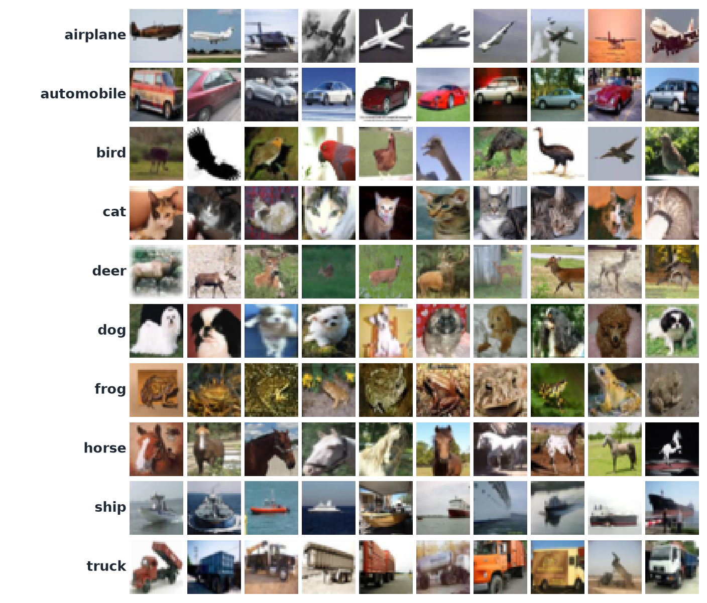

</div>

---

## Results at a glance

| | |
| --- | --- |
| **Test accuracy** | **77.57%**, or 7,757 of 10,000 untouched test images |
| **Test loss** | 0.6541 |
| **Macro F1** | 77.40% |
| **Best validation accuracy** | 77.88% at epoch 17, the checkpoint used for test |
| **Model** | 2-conv-block CNN, **1.07 M parameters**, random initialisation |
| **Easiest class / hardest class** | automobile (F1 88.2%) / cat (F1 59.1%) |
| **Biggest confusion** | cat ↔ dog: 160 cats called dogs and 164 dogs called cats |

> The validation accuracy (77.88%) and the test accuracy (77.57%) are only 0.31 points apart. That suggests the validation-only model selection didn't overfit the validation set.

---

## Contents

- [What this project is (and is not)](#what-this-project-is-and-is-not)
- [Workflow](#workflow)
- [Dataset and splits](#dataset-and-splits)
- [Preprocessing and augmentation](#preprocessing-and-augmentation)
- [Model](#model)
- [Training](#training)
- [Experiments](#experiments)
- [Final test evaluation](#final-test-evaluation)
- [Error analysis](#error-analysis)
- [Reproduce](#reproduce)
- [Repository layout](#repository-layout)
- [Key concepts](#key-concepts)
- [Limitations and next steps](#limitations-and-next-steps)

---

## What this project is (and is not)

| ✅ It is | ❌ It is not |
| --- | --- |
| A CNN designed by hand from `Conv2d`, `ReLU`, `MaxPool2d`, `Dropout` and `Linear` | A pretrained ResNet, YOLO or transfer-learning project |
| A training and validation loop written by hand | `model.fit()`, Lightning, or a one-command trainer |
| A reproducible, seeded, stratified 45k / 5k / 10k protocol | Tuning on the test set |
| Experiments that change one variable at a time, tracked in TensorBoard | Manual backpropagation (PyTorch autograd computes the gradients) |

The aim is to learn the full, reliable machine-learning workflow around a neural network, not just to get one accuracy number.

---

## Workflow

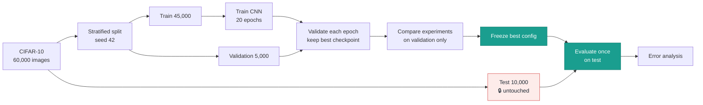

---

## Dataset and splits

CIFAR-10 has 60,000 colour images of **3 × 32 × 32** pixels in 10 balanced classes: airplane, automobile, bird, cat, deer, dog, frog, horse, ship and truck.

| Split | Images | Per class | Purpose |
| --- | ---: | ---: | --- |
| Training | 45,000 | 4,500 | Learn weights and biases |
| Validation | 5,000 | 500 | Choose architecture, learning rate, augmentation, dropout and stopping epoch |
| Test | 10,000 | 1,000 | **One** final evaluation after the configuration is frozen |

- The 50,000 official training images are split with a **stratified, seeded (42)** split. The indices are saved to [`splits/`](splits/) so every run uses exactly the same images.
- CIFAR-10 images are independent examples, so a random stratified split is fine. With video or driving data you would split by scene or sequence instead, to avoid leakage.
- Exploration notebook: [`notebooks/01_data_exploration.ipynb`](notebooks/01_data_exploration.ipynb). It covers image shape and pixel ranges, random sample grids and class balance.

---

## Preprocessing and augmentation

| | Training | Validation / test |
| --- | :---: | :---: |
| `ToTensor()` | ✅ | ✅ |
| `RandomCrop(32, padding=4)` | ✅ | — |
| `RandomHorizontalFlip()` | ✅ | — |
| `Normalize(mean=(0.4914, 0.4822, 0.4465), std=(0.2470, 0.2435, 0.2616))` | ✅ | ✅ |

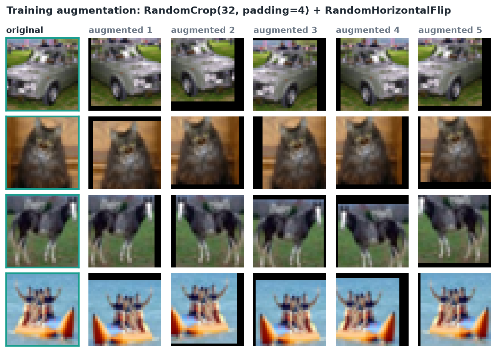

Vertical flips are deliberately left out, because upside-down objects aren't representative of CIFAR-10. Labels stay as integers 0–9, with no one-hot encoding, as `nn.CrossEntropyLoss` expects.

---

## Model

`SmallCNN` in [`src/model.py`](src/model.py) has two convolution blocks followed by a two-layer classifier. It outputs raw logits, with no softmax inside the model.

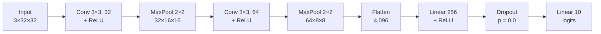

| Layer | Output shape | Parameters |
| --- | --- | ---: |
| Conv2d(3 → 32, 3×3) + ReLU + MaxPool | 32 × 16 × 16 | 896 |
| Conv2d(32 → 64, 3×3) + ReLU + MaxPool | 64 × 8 × 8 | 18,496 |
| Linear(4096 → 256) + ReLU + Dropout | 256 | 1,048,832 |
| Linear(256 → 10) | 10 | 2,570 |
| **Total** | | **1,070,794** |

Almost 98% of the parameters sit in the first fully connected layer.

---

## Training

The loop in [`src/train.py`](src/train.py) is written by hand:

```python
model.train()
for images, labels in train_loader:
    optimizer.zero_grad()            # clear gradients from the previous batch
    logits = model(images)           # forward pass
    loss = loss_function(logits, labels)
    loss.backward()                  # autograd computes gradients
    optimizer.step()                 # AdamW updates weights
```

After every epoch, the model runs on validation data under `model.eval()` and `torch.no_grad()`. The checkpoint with the **best validation accuracy** is saved, and loss, accuracy and learning rate are logged to TensorBoard.

| Setting | Value |
| --- | --- |
| Loss | `nn.CrossEntropyLoss()` |
| Optimiser | AdamW, learning rate 1e-3 |
| Epochs | 20 (best checkpoint kept) |
| Batch size | 128 train / 256 evaluation |
| Augmentation | random crop + horizontal flip |
| Dropout | 0.0 |
| Seed | 42 |
| Device | CPU |

### Learning curves of the selected model

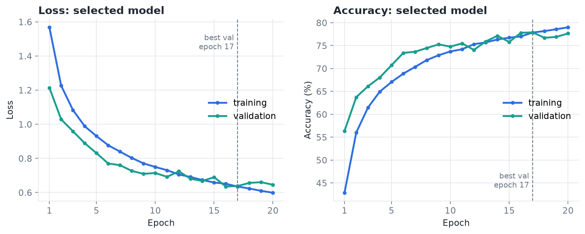

Training and validation curves stay close together the whole way, so the model is **generalising** rather than memorising. Validation accuracy peaks at epoch 17 (77.88%), and that checkpoint is the one used for testing.

---

## Experiments

Each run answers **one question** by changing one setting. Decisions were based on **validation accuracy only**.

| ID | Change | Best val. accuracy | Best epoch | What it tells us |
| :---: | --- | ---: | :---: | --- |
| 0 | Crop + horizontal-flip augmentation | 77.66% | 20 | Augmented baseline |
| 1 | No augmentation | 74.22% | 8 | Augmentation adds **+3.4 points** |
| 2 | Seeded baseline, learning rate 1e-3 | 77.74% | 20 | Reference for the learning-rate comparison |
| 3 | Learning rate 3e-4 | 74.18% | 18 | Too slow to converge in 20 epochs |
| 4 | Dropout removed (p = 0.0) | **77.88%** | 17 | Slightly better than p = 0.3 → **selected** |

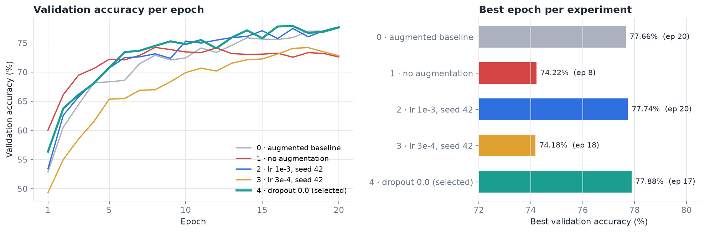

### Why augmentation matters

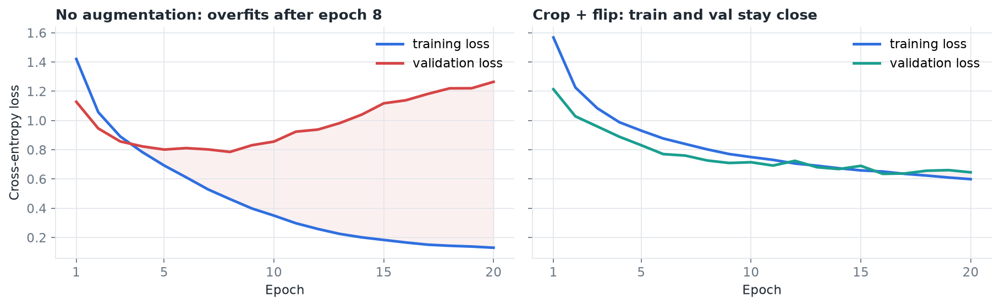

Without augmentation, training accuracy climbs to **95.4%** by epoch 20, but validation accuracy **falls** to 72.6% after peaking at epoch 8. That's classic overfitting. With crop and flip, training and validation stay within about 1 point of each other.

### Selected configuration

```text
Augmentation:   random crop (padding 4) + horizontal flip
Learning rate:  0.001 (AdamW)
Dropout:        0.0
Seed:           42
Best val. acc.: 77.88% at epoch 17
Checkpoint:     checkpoints/augmented_dropout0_0_1e-3_seed42/best_model.pt
```

---

## Final test evaluation

The frozen checkpoint was evaluated **once** on the 10,000 official test images, and the model wasn't changed afterwards.

| Metric | Value |
| --- | ---: |
| Test accuracy | **77.57%** |
| Test loss | 0.6541 |
| Macro precision / recall / F1 | 77.52% / 77.57% / 77.40% |

Source: [`reports/final_test_result.json`](reports/final_test_result.json).

### Per-class performance

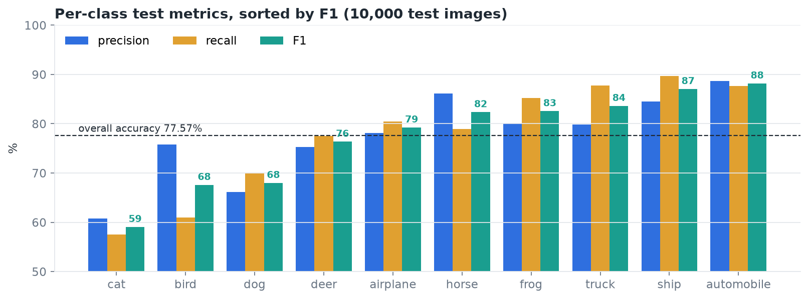

| Class | Precision | Recall | F1 |
| --- | ---: | ---: | ---: |
| automobile | 88.68% | 87.70% | **88.19%** |
| ship | 84.54% | 89.70% | 87.05% |
| truck | 79.82% | 87.80% | 83.62% |
| frog | 80.08% | 85.20% | 82.56% |
| horse | 86.14% | 78.90% | 82.36% |
| airplane | 78.13% | 80.40% | 79.25% |
| deer | 75.24% | 77.50% | 76.35% |
| dog | 66.10% | 70.00% | 67.99% |
| bird | 75.78% | 61.00% | 67.59% |
| cat | 60.72% | 57.50% | **59.07%** |

Source: [`reports/per_class_metrics.json`](reports/per_class_metrics.json).

**Reading the cat row:** recall of 57.5% means the model found 575 of the 1,000 real cats. Precision of 60.7% means that when it said "cat", it was right about 61% of the time. F1 of 59.1% balances the two.

Vehicles (automobile, ship, truck) are the easiest classes. Animals with similar shape and texture (cat, dog, bird) are the hardest.

---

## Error analysis

### Confusion matrix

<table>
<tr>
<td width="52%">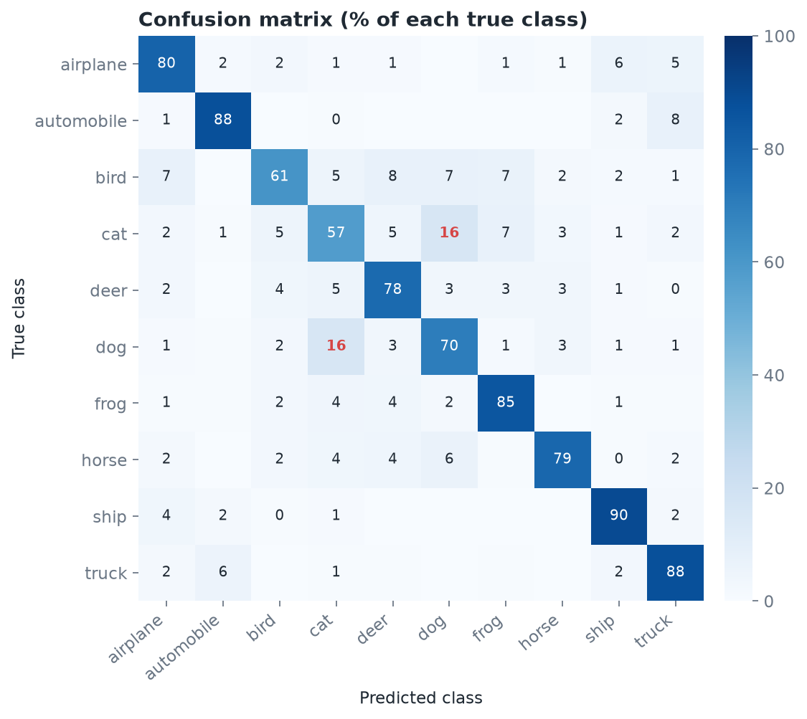</td>
<td width="48%">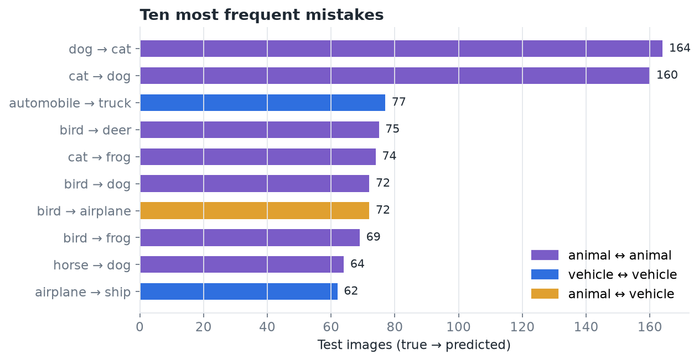</td>
</tr>
</table>

<details>
<summary>Raw-count confusion matrix (from <code>src/analyze_errors.py</code>)</summary>
<br>
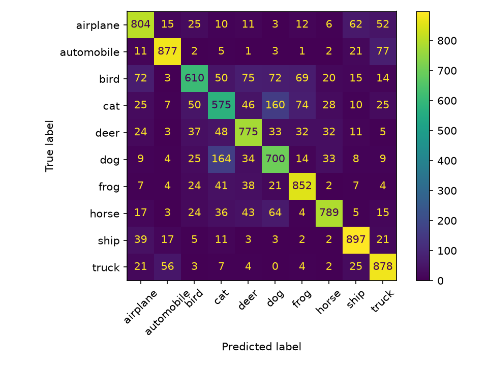
</details>

**Observations:**

- **Cat ↔ dog dominates.** 160 cats were predicted as dogs and 164 dogs as cats. That's 16% of each class, and the two largest off-diagonal cells by a wide margin.
- **Bird is the most scattered class.** Its errors spread over deer (75), dog (72), airplane (72) and frog (69). Small birds against sky or grass lose their shape at 32 × 32.
- **Vehicle confusions follow shape similarity:** automobile → truck (77), airplane → ship (62) and truck → automobile (56). Sky and water backgrounds look alike at low resolution.
- 8 of the 10 most frequent mistakes are between two animals, or between two vehicles. The model has clearly learned the coarse animal-vs-vehicle split.

### Confidently wrong predictions

Mistakes made with ≥ 99% confidence. Most come from unusual poses, backgrounds that resemble another class (a blue sky gives "airplane"), or cropped objects.

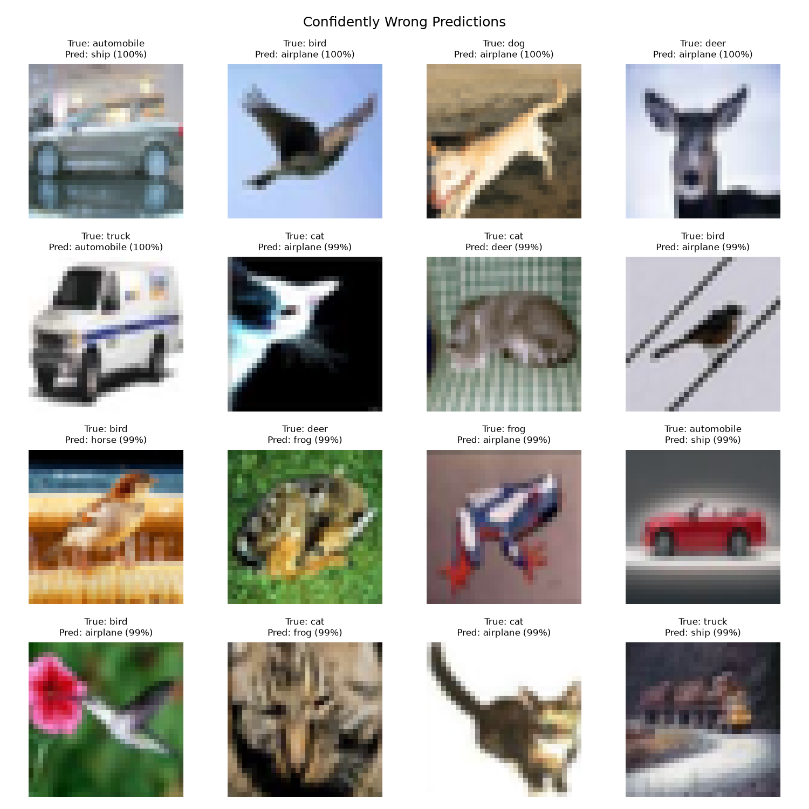

### Least-confident predictions

The images the model was least sure about, with the top class at only 18–24% probability. Many are extreme close-ups or partial views, such as a car's tail-light, a horse's head or a ship's bow. Others have clutter, such as a rider beside a horse. Only 3 of these 16 are classified correctly.

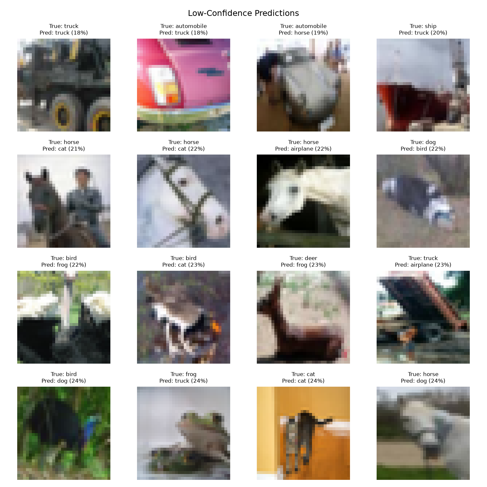

---

## Reproduce

```bash
python -m venv .venv
source .venv/bin/activate          # Windows: .venv\Scripts\activate
python -m pip install -r requirements.txt

python -m src.create_splits        # stratified 45k/5k split, seed 42 → splits/
python -m src.train                # trains the config set at the top of src/train.py
tensorboard --logdir runs          # learning curves
python -m src.evaluate             # one-time test evaluation → reports/final_test_result.json
python -m src.analyze_errors       # per-class metrics + confusion / error grids
```

CIFAR-10 downloads automatically to `data/` through Torchvision. The experiment name, learning rate, augmentation flag and seed are constants at the top of [`src/train.py`](src/train.py). Change **one** at a time to repeat the experiment table.

<details>
<summary><b>Regenerate the README figures</b></summary>

```bash
pip install matplotlib numpy pillow tensorboard
python scripts/make_readme_figures.py
```

The script reads the TensorBoard logs in `runs/` (kept locally, not in Git), the local CIFAR-10 copy in `data/`, and the tracked reports. Its output goes to `reports/figures/readme/`.
</details>

---

## Repository layout

```text
Supervised_learning_CIFAR10/
├── src/
│   ├── create_splits.py     # stratified, seeded train/validation split
│   ├── data.py              # transforms, split-aware Datasets and DataLoaders
│   ├── model.py             # SmallCNN (1.07M parameters)
│   ├── train.py             # manual training + validation loop, TensorBoard, checkpointing
│   ├── evaluate.py          # one-time test-set evaluation
│   └── analyze_errors.py    # per-class metrics, confusion matrix, error grids
├── notebooks/
│   └── 01_data_exploration.ipynb
├── splits/                  # saved train/validation indices (seed 42)
├── reports/
│   ├── final_test_result.json
│   ├── per_class_metrics.json
│   └── figures/             # confusion matrix, error grids, README charts
├── scripts/
│   └── make_readme_figures.py
├── PROJECT_REPORT.md        # plain-language results report
├── README_old.md            # original step-by-step project plan
└── requirements.txt
```

`data/`, `checkpoints/` and `runs/` are git-ignored.

---

## Key concepts

| Concept | Simple meaning |
| --- | --- |
| CNN | A neural network that learns spatial patterns in images |
| Epoch | One full pass over the training images |
| Augmentation | Small random image changes that help the model generalise |
| Loss | How wrong the model is; lower is better |
| Validation set | Separate data used to make development decisions |
| Test set | Untouched data used once to report final performance |
| Checkpoint | Saved weights from the best validation epoch |
| Underfitting | Training and validation are both poor |
| Overfitting | Training improves while validation stalls or worsens (see experiment 1) |
| Precision / recall / F1 | Correctness of predictions / coverage of real examples / their balance |

---

## Limitations and next steps

- **Low resolution:** at 32 × 32, small animals and fine details are hard to tell apart.
- **One small architecture and one seed:** the differences between experiments 0, 2 and 4 (77.66–77.88%) are within the noise you'd expect between seeds.
- **Short training:** 20 epochs with no learning-rate schedule. The selected run's training accuracy was still rising.
- **Possible next experiments,** each chosen on validation, never on this test result:
  - Compare AdamW with SGD + momentum.
  - Add a third convolution block or batch normalisation.
  - Add a learning-rate schedule.
  - Repeat runs over several seeds.
- The next project in the series is a NumPy MLP with hand-written backpropagation.

---

<sub>See [`PROJECT_REPORT.md`](PROJECT_REPORT.md) for a plain-language results report and [`README_old.md`](README_old.md) for the original milestone-by-milestone plan.</sub>
